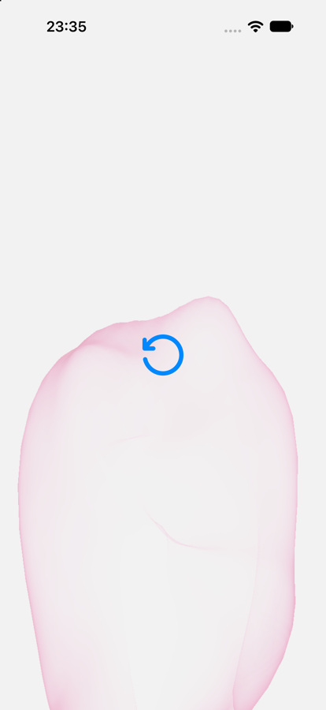

# swiftui interactions

small experiments in motion, materials, and interaction, built with swiftui and apple frameworks.

these are working prototypes to learn from, fork, and make your own. they explore how an interaction feels; they are not production-ready components or physically exact simulations.

## experiments

### bubblegum

blow into your iphone’s microphone to inflate a soft pink bubble. tilt the phone to make it sway, then keep blowing until the membrane tears and sticks to the glass.



**swiftui · metal · avaudioengine · core motion**

[open the experiment →](Experiments/Bubblegum/README.md)

## run locally

1. fork this repository, then clone your fork (or download the zip).
2. open `SwiftUI-Interactions.xcworkspace` in xcode 26 or later.
3. select the **bubblegum** scheme and an iphone simulator, then run.
4. for microphone and motion input, use a real iphone. in **signing & capabilities**, select your own development team and change the bundle identifier to something unique.

bubblegum supports ios 18+. liquid glass is used on ios 26+ with a solid-color fallback on older versions. the current snapshot was build-checked with xcode 27. no third-party packages, api keys, or backend are required. the simulator works without code signing.

**simulator controls:** in a debug build, hold the upper-right corner for one second to reveal manual inflation and diagnostics. device microphones and movement cannot be judged from a simulator.

## add an experiment

```sh
python3 scripts/new-experiment.py Ripple
```

this creates a standalone swiftui app in `Experiments/Ripple`, gives it a shared xcode scheme, and adds it to the workspace. replace its starter view, update its readme, and add a preview and link to this gallery.

each experiment owns its app, assets, and requirements. a change to one experiment should not require updating every other experiment.

see [contributing.md](CONTRIBUTING.md) for the workflow and [the experiment readme template](Templates/README.md).

## checks

on a mac with xcode selected:

```sh
./scripts/check-bubblegum.sh
./scripts/build.sh Bubblegum
```

the first command runs focused deterministic checks for breath detection, rupture, sway, and fragment geometry. the second builds the ios simulator app. they do not replace real-device interaction and audio checks.

no automatic cloud builds are configured. run these focused checks locally before pushing; add ci when there is a reason to spend runner time.

## license and credits

original code and project-owned assets use the custom [swiftui interactions attribution license](LICENSE). **commercial use is allowed. link to [kagan.in](https://kagan.in) in your product’s about/credits screen, or obtain written permission to omit that credit.** you can keep your own app’s source private.

see [attribution.md](ATTRIBUTION.md) for a copyable credit, placement examples, and permission requests. this is a custom license, not an osi-approved open-source license. the bundled sound has separate conditions in [third_party_notices.md](THIRD_PARTY_NOTICES.md).
