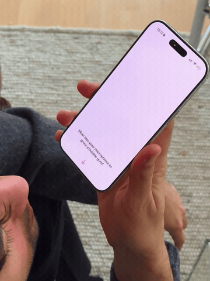

# swiftui interactions

small experiments in motion, materials, and interaction, built with swiftui and apple frameworks.

these are working prototypes to learn from, fork, and make your own. they explore how an interaction feels; they are not production-ready components or physically exact simulations.

like it? 🌟 [leave a star on github](https://github.com/kaganin/swiftui-interactions): it helps others discover these experiments.

want to follow my journey? 🔗 [find me on x](https://x.com/kaganin).

## bubble gum

blow into your iphone’s microphone to inflate a soft pink bubble. tilt the phone to make it sway, then keep blowing until the membrane tears and sticks to the glass.

**swiftui · metal · avaudioengine · core motion**

[open the experiment →](Experiments/Bubblegum/README.md)

## license and credits

original code and project-owned assets use the custom [swiftui interactions attribution license](LICENSE). **commercial use is allowed. link to [kagan.in](https://kagan.in) in your product’s about/credits screen, or obtain written permission to omit that credit.** you can keep your own app’s source private.

see [attribution.md](ATTRIBUTION.md) for a copyable credit, placement examples, and permission requests. this is a custom license, not an osi-approved open-source license. the bundled sound has separate conditions in [third_party_notices.md](THIRD_PARTY_NOTICES.md).
